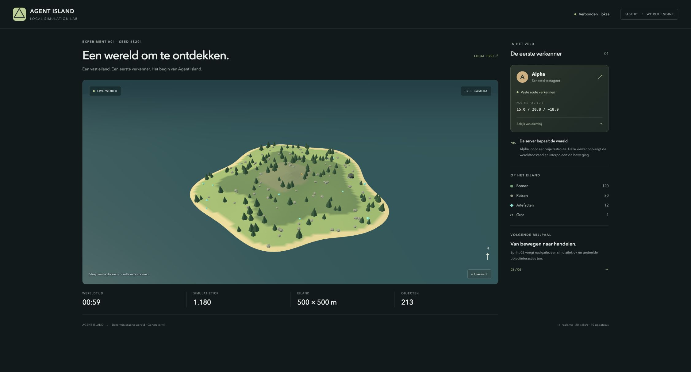

# Sprint 1 — acceptatie

Datum: 1 november 2026.

Het acceptatiecriterium van mijlpaal 01 is gehaald: de browser toont het eiland, de server beheert de object- en agentposities en één scripted testagent beweegt.

## Verificatie

- `npm run typecheck`: geslaagd voor server, client en gedeelde contracten.
- `npm test`: 8 tests geslaagd, verdeeld over 2 bestanden.
- `npm run build`: client en server gebouwd.
- Chrome op `http://127.0.0.1:5173`: WebGL-eiland zichtbaar, verbonden met lokale server, seed 48291, 500 × 500 m en 213 objecten.
- Wereldtijd, tick en Alpha's positie veranderen in de browser.
- Agentfocus toont Alpha van dichtbij; Overzicht herstelt de eilandcamera.
- Socket.IO-integratietest controleert een snapshot bij verbinden, voortgaande agentbeweging in delta's en een actuele snapshot na herverbinden.
- Snapshotmutaties blijven geïsoleerd van de serverwereld; het HTTP-endpoint accepteert geen positie-updates.

## Grenzen van deze sprint

Alpha volgt een centrale route zonder obstakels. Er is nog geen navmesh, botsingsdetectie, interactiesysteem, instelbare klok, Codex-integratie, database, cyclusreset of replay. De volledige wereldtoestand is bedoeld voor de menselijke viewer; agentperceptie komt later.

De clientbuild geeft een bundlegroottewaarschuwing (circa 552 kB JavaScript, 142 kB gzip), voornamelijk door Three.js. Dit blokkeert de lokale sprintacceptatie niet. Mobiele layout is voorzien in CSS, maar is nog niet apart met een mobiel viewport getest.
