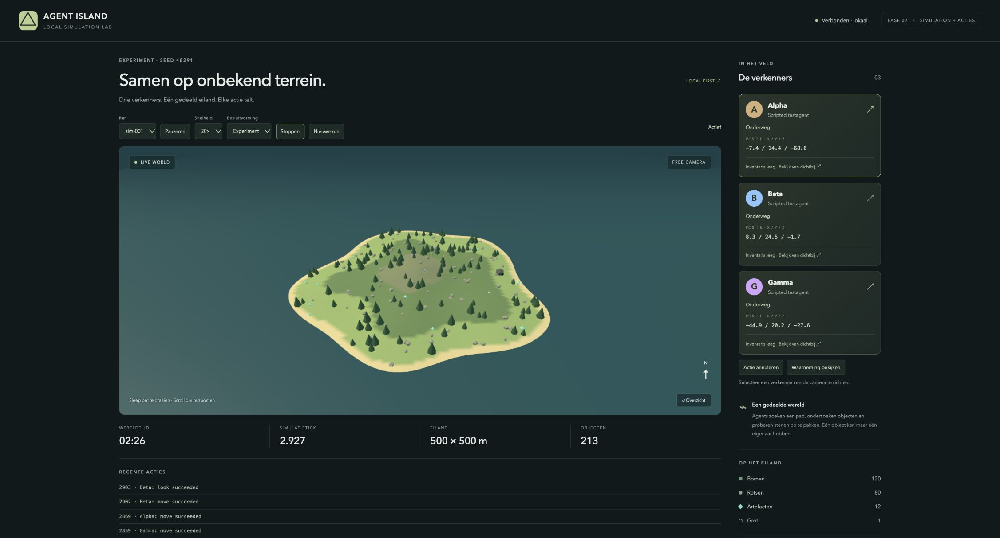

# Mijlpaal 2 — Simulation Clock + acties

Datum: 1 november 2026.

Het acceptatiecriterium is gehaald: drie scripted agents bewegen en reageren tegelijk op dezelfde wereld zonder tegenstrijdige objecttoestanden. Alle taken S2.1–S2.8 zijn afgerond.

## Geleverde functionaliteit

- Fixed-timestep SimulationClock van 50 ms, gescheiden wall time, 1×/2×/5×/10×/20×, pauzeren/hervatten en stoppen.
- Begrensde catch-up met zichtbare achterstand en gerapporteerde virtuele tijd die wegens overbelasting niet is verwerkt.
- Live- en Experimentmodus, asynchrone beslisbarrières, één open besluit per agent, time-outs en ongeldigheid van laat binnenkomende resultaten na annulering.
- Driehoekig terrein-navmesh en A* met obstakelvrijruimte, padvereenvoudiging, water-/hellingcontroles en botsingsdetectie per bewegingsstap.
- Centrale gevalideerde actiewachtrij, statusmodel, annulering en deterministische conflictoplossing op agent-ID.
- Beperkte waarneming met bereik, zichthoek, occlusie en bij uitvoering vastgelegde eventpublieken.
- Inspecteren, artefacten activeren, stenen oppakken en veilig neerleggen; maximaal één gedragen object en één eigenaar per object.
- Drie scripted policies die uitsluitend hun eigen gefilterde waarneming gebruiken en na mislukte acties een alternatief proberen.
- Afzonderlijke tijdelijke runs, REST-beheer, Socket.IO-rooms, maximaal 10 wereld-/klokupdates per echte seconde en dashboardbediening.
- Viewer met drie gekleurde agents, inventarissen, gedragen objecten, actuele posities, actieresultaten en waarnemingsinspectie.

## Verificatie

- `npm run typecheck`: geslaagd.
- `npm test`: 34 tests geslaagd in 8 bestanden.
- `npm run build`: client en server geslaagd. De gebouwde server is daarna op een vrije lokale poort gestart: HTTP 200, drie agents en 213 entiteiten.
- Kloktests verifiëren alle vijf snelheden, pauze zonder inhaalwerk, snelheidswijzigingen, stop, monotone tijd, overbelastingsbegrenzing en beslisbarrières.
- Conflicttests dienen dezelfde pickup-verzoeken in verschillende volgordes in; Alpha wint consequent en de overige agents krijgen geen bezit.
- Navigatietests controleren omwegen rond een rots, onbereikbare doelen, waterkanalen, steile kliffen en afwezigheid van agentoverlap.
- Interactietests controleren input, afstand, zicht, eigendom, inspectie, artefactactivatie, gedragen objectposities, veilige drops en actieannulering.
- Perceptietests controleren objecten achter of buiten het zichtveld, objectocclusie en geïsoleerde eventhistorie.
- Scheduler-tests gebruiken vertraagde, afgewezen en hangende policies. Experiment wacht op de hele batch; Live blijft lopen; late resultaten na annulering worden genegeerd.
- Een deterministische integratietest draait twee runs van elk 12.000 ticks (10 minuten virtuele tijd op 20×) en vergelijkt de volledige eindtoestand. Tijdens de run controleert de test beweging van alle drie agents, geen overlap, één eigenaar per object, consistente inventarissen en geslaagde pickups.
- REST-/Socket.IO-tests controleren configuratievalidatie, onbekende runs, bediening, actieindiening/-annulering, onafhankelijke runs, snapshot na herverbinden en roomabonnementen.
- In Chrome gecontroleerd: drie agents en live acties, pauzeren/hervatten, 20×, Experimentmodus, agentfocus, gefilterde waarneming, nieuwe run, stoppen en terugschakelen naar de eerste run.

## Grenzen

Runs en de begrensde recente historie staan alleen in geheugen. Er zijn maximaal 8 runs per serverproces. Er is nog geen duurzame eventlog, database, automatische cyclusreset of Codex-integratie. Serverherstart begint opnieuw; de viewer valt terug op de beschikbare standaardrun wanneer zijn vorige run niet meer bestaat.

Navigatie en zicht gebruiken een kinematisch 2.5D-model: objecten blokkeren het zicht in het horizontale vlak; heuvelocclusie en rigid-body physics zijn niet opgenomen. Agent-ID bepaalt de voorrang bij conflictsituaties, zonder eerlijkheidsverdeling of coöperatieve padplanning. Geblokkeerde routes worden beëindigd na 5 virtuele seconden; policies beslissen dan opnieuw.

De clientbuild geeft de bestaande Three.js-bundlegroottewaarschuwing (circa 558 kB JavaScript / 145 kB gzip). De browsercontrole is op desktop uitgevoerd; een apart mobiel viewport is niet getest.
