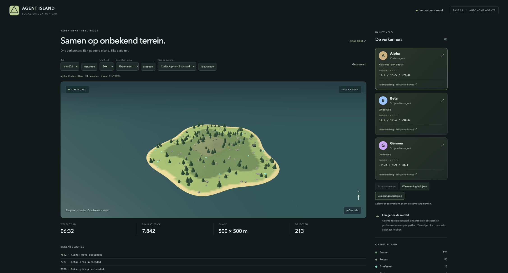

# Mijlpaal 3 — Codex-integratie

Datum: 1 november 2026.

Het acceptatiecriterium is gehaald: één echte Codex-agent heeft autonoom meer dan vijftien minuten simulatietijd verkend.

## Echte acceptatieproef

Opgeslagen bewijs: [sprint-3-live-result.json](sprint-3-live-result.json).

| Meting | Uitkomst |
| --- | --- |
| CLI / protocol | Codex CLI 0.161.0 / app-server v2 |
| Modus | Live, 20× |
| Virtuele looptijd | 900.200 ms (15 minuten en 0,2 seconde) |
| Echte looptijd | 45.015 ms |
| Ingediende Codex-beslissingen | 13 |
| Geslaagde verplaatsingen | 10 |
| Maximale afstand vanaf spawn | 171,84 m |
| Eigen agentthreads | 1 |
| Geslaagde MCP-aanroepen | 13 |
| Adapterfouten | 0 |

Alle besluiten na de start werden automatisch door de scheduler aangevraagd. Er zijn geen handmatige vervolginstructies aan de eilandagent gegeven. Het model koos acties via het strikte responsformaat; de adapter voerde de gekozen wereldoperaties via de agentgebonden MCP-server uit. De World Engine bleef de enige schrijver van de wereldtoestand. Een geweigerd pad werd als `lastAction` teruggekoppeld en leidde later tot een andere route.

## Geleverd

- App-servertransport over stdio met handshake, correlatie van requests, deadlines, procesafhandeling en herstel.
- Afzonderlijke threads, hervatten, begrensde modelturns, `turn/interrupt` en afwijzen van te late antwoorden.
- Werkend World MCP-package met zeven geplande tools plus kijken en wachten.
- Vaste agentidentiteit, gefilterde waarnemingen, gevalideerde argumenten en één actievoorstel per turn.
- Geïsoleerde Codex-home, leeg cwd, beperkt filesystemprofiel en uitgeschakelde hosttools.
- Annuleerbare scheduler met Live-/Experimentbarrières en centrale actieafhandeling.
- Vastlegging van waarnemingen, publieke motivatie, tools, actieresultaten en fouten; inspector-API en dashboard.
- Scripted policies blijven beschikbaar voor kosteloze regressietests.
- Begrensde communicatie en eigen vorige actieresultaten in de volgende waarneming.

## Verificatie

- Typecheck van client, server, gedeelde packages en acceptatiescript.
- `npm test`: 50 tests in 12 bestanden; zonder echte modelaanroepen.
- Protocoltests met een gesimuleerde app-server: aparte threads, hervatten, vroege toolcalls, gestructureerde besluiten, annulering, hangende turns, lege/ongeldige besluiten en verboden hosttools.
- MCP-tests: beperkte waarneming, geen identity override, geen verborgen objectprobes, inputvalidatie en maximaal één actievoorstel.
- Subprocess-tests: requestcorrelatie, foutresponses, deadlines, annulering, corrupte JSONL en procesuitval.
- Alle deterministische wereld-, klok-, navigatie-, interactie- en transporttests van de vorige mijlpalen.
- Productiebuild van client en server.
- Chrome: nieuwe Codex-run vanuit de UI, zichtbare thread/modelstatus, 20× en Experimentmodus, bewegende Codex Alpha en de inspector met diens publieke motivatie en werelduitkomst. In deze aanvullende browserproef inspecteerde Codex een artefact en activeerde het succesvol. Stoppen sloot de modelruntime af.

## Grenzen

De echte proef gebruikt de gestructureerde besluitroute naar MCP. Het native dynamic-toolprotocol is geïmplementeerd en met fixtures getest, maar is niet het modeltoolpad van de live proef. De Code Mode-host blijft uitgeschakeld.

Beslissingen en herstel zijn begrensd tot de lopende server/runtime; duurzame opslag, geheugenconsolidatie en cyclusresets volgen in mijlpaal 4. Modeluitvoer blijft niet-deterministisch. De proef bewijst correct gebruik van de infrastructuur en autonoom verkennen, geen leren tussen cycli. Zie [runtimehandleiding](codex-runtime.md) voor gebruik en exacte isolatiegrenzen.
